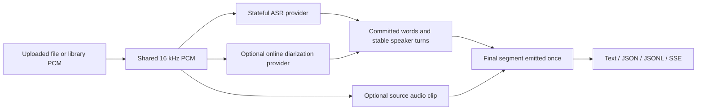

# polyvox

**v1.0.0 — Initial release.**

polyvox is a local speech service and Python library with streaming transcription, optional
speaker diarization, and optional audio clips for each segment. One shared PCM
engine feeds resident speech-recognition and diarization models concurrently.
Final text and speaker labels are emitted together, once per segment.

Choose plain text, a complete JSON document, JSONL, or SSE. Enable diarization and
audio independently per request. Every segment has `start`, `end`, `len`, `text`,
and `speaker`; timestamps and lengths are seconds. With diarization disabled,
`speaker` is `UNKNOWN`. Audio, when requested in a structured format, is an inline
base64 WAV containing that segment's normalized source audio.

## Choose the response you need

| Response | Use it for | Speaker labels | Segment audio |
| --- | --- | --- | --- |
| `text` | Readable captions as finalized segments arrive | Optional | Disabled |
| `json` | One complete transcript for storage or processing | Optional | Optional base64 WAV |
| `jsonl` | Incremental records for scripts and data pipelines | Optional | Optional base64 WAV |
| `sse` | Incremental JSON events for HTTP clients and browser `fetch` | Optional | Optional base64 WAV |

Set `diarization` and `include_audio` independently in query parameters or
multipart fields. Structured segments always include `start`, `end`, and `len`.
A successful event stream ends with `complete`; readable text ends with
`# complete`. An interrupted stream is a partial result.

## How a session produces results



ASR and diarization run concurrently on the same chunks. Each provider is
independently replaceable. A final segment combines its text, timestamps,
speaker label, and optional clip; clients append it without waiting for a later
speaker update. Short holdback protects turn boundaries before publication.

## Quick start

Install Docker with Compose, then run from this directory:

```bash
docker compose up --build
curl http://localhost:8000/ready
curl -N -F 'file=@recording.wav' \
  'http://localhost:8000/transcribe?format=sse&diarization=true&include_audio=true'
```

Both Linux `amd64` and `arm64/v8` CPU images use the same API. Compose binds to
localhost. Both Dockerfiles install FFmpeg, Python dependencies, the native
runtime, and the two default models during the build. Model downloads use pinned
SHA-256 checksums; containers need no model downloads or host model mounts.
For native installation and acceleration, see [macOS](RUN_ON_MAC.md),
[Windows](RUN_ON_WINDOWS.md), [Linux](RUN_ON_UBUNTU.md), and [hardware](HARDWARE.md).

## Models and replacement

The default recognizer is NVIDIA Nemotron 3.5 ASR Streaming 0.6B, Q8 GGUF
(**742 MB**). It offers streaming word timestamps and multilingual recognition.
The optional Nemotron 3 Diarization 100M model is **107 MB** in Q8 GGUF and tracks
up to eight speakers. Together they occupy about **849 MB on disk**; working RAM
and GPU memory are additional. English-only deployments can select the roughly
700 MB `nemotron-en` recognizer. See the model cards linked in [LIBRARY.md](LIBRARY.md).

Python calls the pinned NeMo-Speech.cpp v0.3.0 C SDK. The core installation needs
neither PyTorch nor a Hugging Face token. Change `MODEL_PATH` or
`DIARIZATION_MODEL` to use compatible model files. Independently replace either
implementation through `ASR_PROVIDER` / `DIARIZATION_PROVIDER` factories; the
engine and HTTP contract stay the same. [LIBRARY.md](LIBRARY.md) documents the
provider interfaces, timestamp requirements, and runnable usage.

## API and library

```bash
# Streaming text, with speakers
curl -N -F 'file=@recording.wav' \
  'http://localhost:8000/transcribe?format=text&diarization=true'

# Complete JSON, including clips; options may also be multipart fields
curl -F 'file=@recording.wav' -F 'format=json' \
  -F 'diarization=true' -F 'include_audio=true' http://localhost:8000/transcribe
```

```python
from polyvox import Settings, Transcriber

service = Transcriber(Settings())
result = service.transcribe("recording.wav", diarization=True, include_audio=True)
with service.stream("recording.wav", diarization=True) as events:
    for event in events:
        print(event)
```

The public `Engine` also accepts live mono 16 kHz PCM chunks. HTTP currently
accepts an uploaded file, decodes it, then streams results; it is not a microphone
upload/WebSocket endpoint. Final caption latency depends on model buffering,
endpointing, diarization holdback, and hardware. Speaker labels are estimates,
may be `UNKNOWN`, and are local to a session; they are not identities. No
whole-file diarization pass or later segment relabeling is performed.

The service isolates each job in a subprocess, limits admission and output,
kills timed-out workers, and retries eligible failures before publishing the
first segment. Streams require a terminal `complete` event (or `# complete` in
text); partial output alone does not establish success. Jobs are not durable.

## Server image builds

`./build-server.sh v1.0.0` (or `build-server.bat v1.0.0` on Windows) builds and
publishes `jchristn77/polyvox-server:v1.0.0` and `:latest` through
`cloud-jchristn77-jchristn77`, for Linux amd64 and arm64/v8. The supplied tag is
required; both tags refer to the same build. See [publishing setup](GETTING_STARTED.md#publish-the-server-image)
for authentication and the distinction between local builds and publication.

## Postman import

Drag [Polyvox.postman_collection.json](postman/Polyvox.postman_collection.json) and
[Polyvox.local.postman_environment.json](postman/Polyvox.local.postman_environment.json)
into Postman's **Import** window, then select **Polyvox - Local**. The collection
includes documented requests, saved responses, and `{{variables}}` for the server,
authentication, input file, output format, diarization, and audio clips.
See the [import instructions](postman/README.md) for local file selection.

## Documentation

- [REST API](REST_API.md), [OpenAPI contract](openapi.yaml), [Postman](postman/README.md)
- [Library and model adapters](LIBRARY.md), [HTTP client example](examples/README.md)
- [Docker setup](GETTING_STARTED.md), [CLI](EXAMPLE_CLI.md), [hardware](HARDWARE.md)
- [Testing and CI](TESTING.md), [changelog](CHANGELOG.md)
